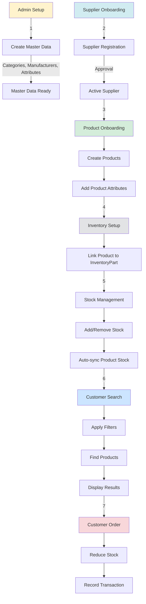
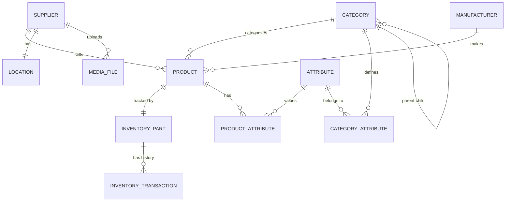

# Part API - UML Flow Documentation

This directory contains comprehensive UML sequence diagrams and flow charts for the Part API system.

## 📋 Table of Contents

1. [Supplier Onboarding Flow](./supplier-onboarding-flow.md)
2. [Product Onboarding Flow](./product-onboarding-flow.md)
3. [Inventory Management Flow](./inventory-management-flow.md)
4. [Part Searching Flow](./part-searching-flow.md)

---

## 🏪 1. Supplier Onboarding Flow

**Purpose**: Manage the complete lifecycle of supplier registration and approval.

**Key Flows**:
- Supplier registration with location and documents
- Upload trade licenses and certificates
- Admin approval workflow (Approve/Reject)
- Supplier profile management

**Entities Involved**:
- Supplier
- Location
- MediaFile

[View Details →](./supplier-onboarding-flow.md)

---

## 📦 2. Product Onboarding Flow

**Purpose**: Enable suppliers to add products to the catalog with full specifications.

**Key Flows**:
- Master data setup (Categories, Manufacturers, Attributes)
- Product creation with attributes
- Category-attribute mapping
- Product-Inventory linkage

**Entities Involved**:
- Product
- Category
- Manufacturer
- Attribute
- ProductAttribute
- CategoryAttribute
- InventoryPart

[View Details →](./product-onboarding-flow.md)

---

## 📊 3. Inventory Management Flow

**Purpose**: Track stock movements and maintain inventory accuracy.

**Key Flows**:
- Add stock (Stock IN) with audit trail
- Remove stock (Stock OUT) for orders
- Product-InventoryPart synchronization
- Stock reconciliation
- Transaction history (Audit)
- Low stock alerts

**Entities Involved**:
- InventoryPart
- Product
- InventoryTransaction

**Key Features**:
- Automatic Product.stock sync when inventory changes
- Full audit trail for all stock movements
- Stock validation before removal
- Low stock threshold alerts

[View Details →](./inventory-management-flow.md)

---

## 🔍 4. Part Searching Flow

**Purpose**: Enable customers to find parts using multiple search criteria.

**Search Types**:
1. **Simple Category Search** - Browse by category
2. **Location-based Search** - Find suppliers in specific areas
3. **Attribute-based Search** - Filter by specifications (e.g., Viscosity, Material)
4. **Vehicle Compatibility Search** - Find parts for specific Year/Make/Model
5. **Complex Multi-filter Search** - Combine category + location + attributes + vehicle
6. **Part Number Search** - Direct exact match

**Entities Involved**:
- Product
- Category
- Supplier
- Location
- ProductAttribute
- Attribute

**Search Flow**:
```
Customer Query → Filters Applied → Database Query → Result Enrichment → Display
```

[View Details →](./part-searching-flow.md)

---

## 🔗 Complete System Flow



---

## 🎯 System Architecture Overview

### Core Components

**1. Controller Layer**
- REST endpoints
- Request validation
- Response formatting

**2. Service Layer**
- Business logic
- Data transformation
- Cross-entity operations

**3. Repository Layer**
- Database access
- Query methods
- JPA operations

**4. Entity Layer**
- Database models
- Relationships
- Constraints

---

## 📊 Key Entity Relationships



---

## 🚀 API Workflow Summary

| Step | Actor | Action | Outcome |
|------|-------|--------|---------|
| 1 | Admin | Setup master data | Categories, Manufacturers, Attributes created |
| 2 | Supplier | Register account | Supplier created (Pending approval) |
| 3 | Admin | Approve supplier | Supplier status = Active |
| 4 | Supplier | Create products | Products added to catalog |
| 5 | Supplier | Add inventory | InventoryPart linked to Product |
| 6 | Warehouse | Manage stock | Stock IN/OUT with audit trail |
| 7 | Customer | Search parts | Filtered results based on criteria |
| 8 | Customer | Place order | Stock reduced, transaction recorded |

---

## 🔐 Data Flow Security

- **DTO Pattern**: All controllers use Request DTOs (not entities)
- **Validation**: Input validation at service layer
- **Audit Trail**: All inventory changes tracked
- **Separation**: Product (catalog) vs InventoryPart (warehouse)

---

## 📌 Business Rules

### Supplier Management
- Supplier must have location
- Account status: PENDING → ACTIVE/REJECTED
- Trade license required

### Product Management
- Product must belong to a category
- Product must have a manufacturer
- Attributes must match category requirements
- UUID auto-generated for Product ID

### Inventory Management
- InventoryPart links to Product via productId
- Stock changes auto-sync to Product.stock
- All transactions audited
- Stock cannot go negative

### Search
- Supports multiple filter combinations
- Results enriched with attributes and supplier info
- Vehicle compatibility based on Year/Make/Model

---

## 🛠️ Viewing Diagrams

These Markdown files contain Mermaid diagrams. To view them:

1. **GitHub** - Renders automatically
2. **VS Code** - Install "Markdown Preview Mermaid Support" extension
3. **Online** - Use [Mermaid Live Editor](https://mermaid.live/)

---

## 📝 Notes

- All sequence diagrams show happy path flows
- Error handling is indicated with `alt` blocks
- Database operations are shown at granular level
- Auto-generated fields (UUID, timestamps) are highlighted

---

**Generated for**: Part API - Supplier and Inventory Management System
**Last Updated**: 2025
**Version**: 1.0