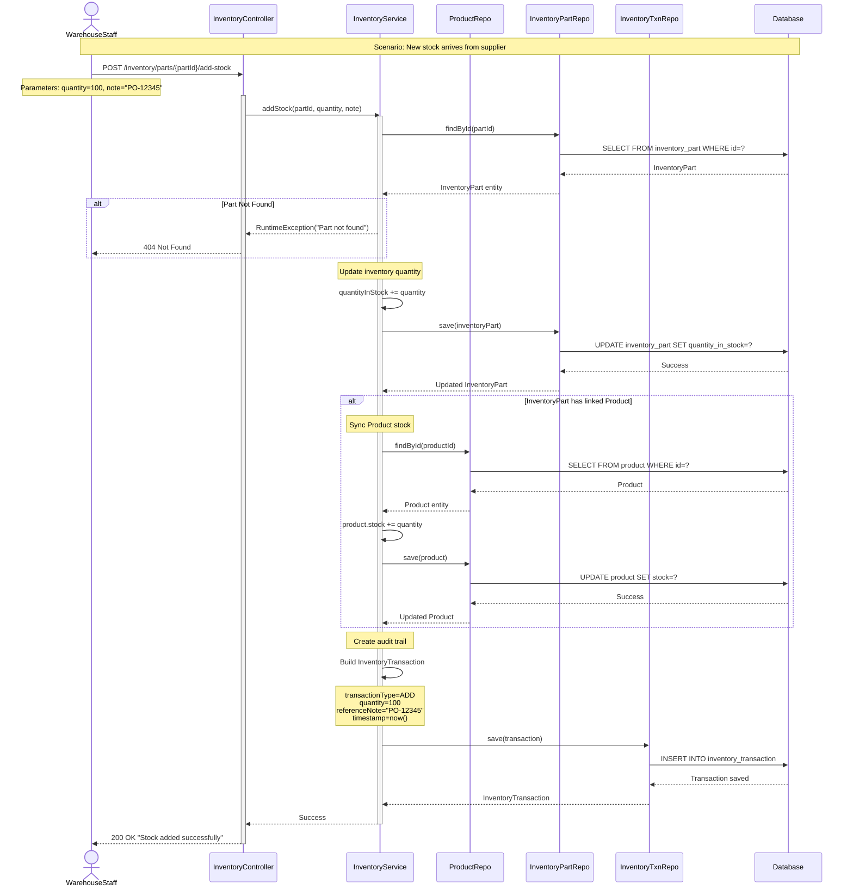
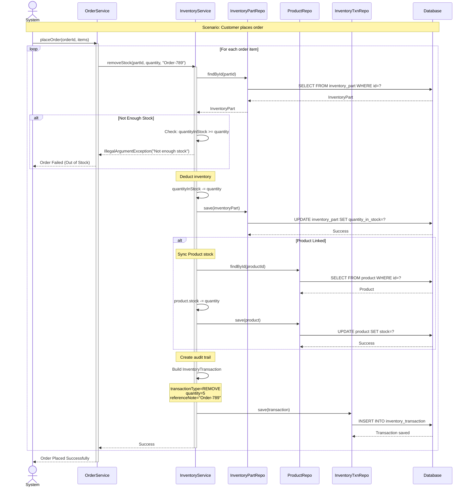
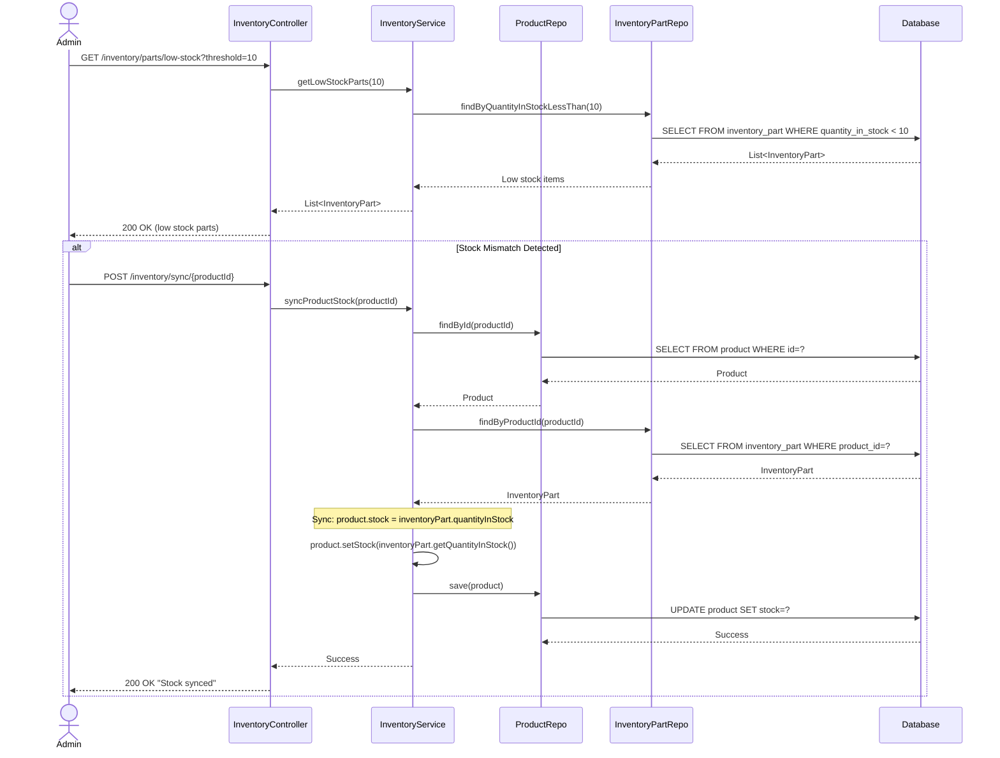
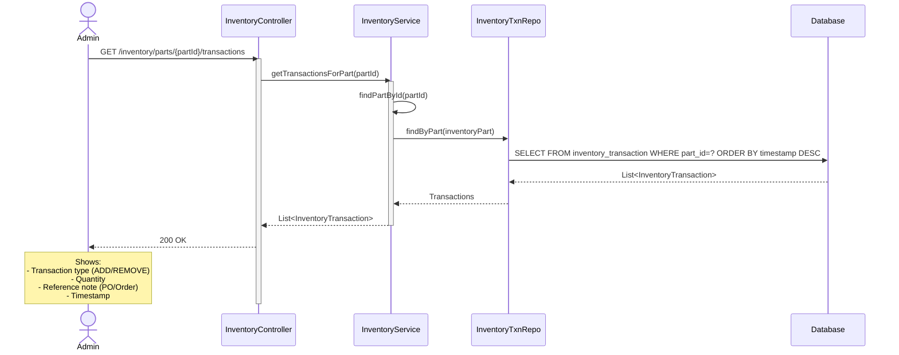
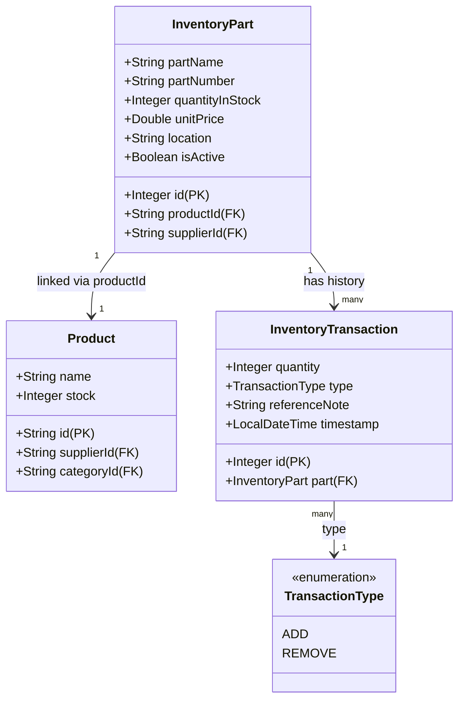
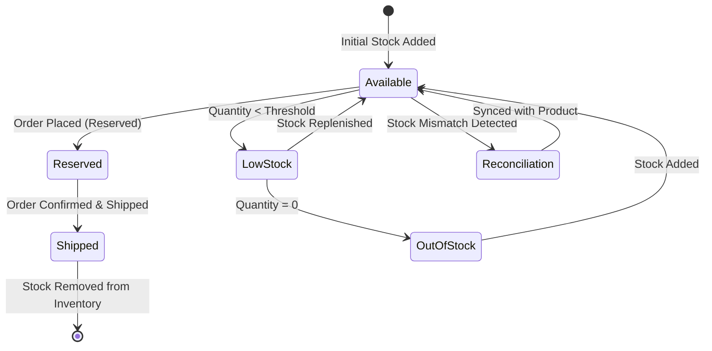

# Inventory Management Flow - UML Sequence Diagram

## 1. Add Stock to Inventory (Stock IN)

## 2. Remove Stock from Inventory (Stock OUT)

## 3. Stock Reconciliation & Sync

## 4. View Inventory Transactions (Audit Trail)

## 5. Inventory Entity Relationships

## 6. Stock Flow State Diagram

