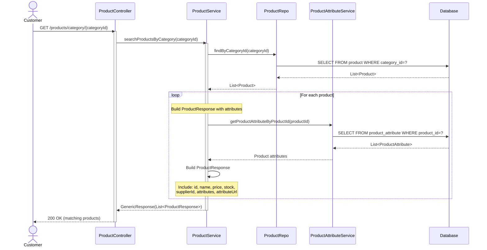
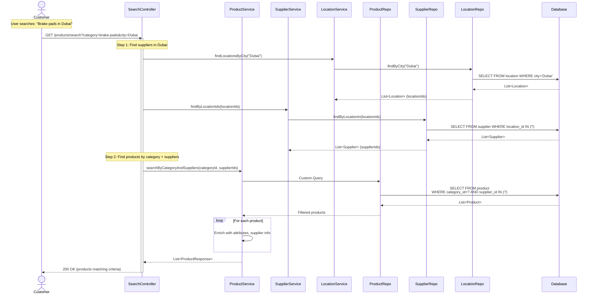
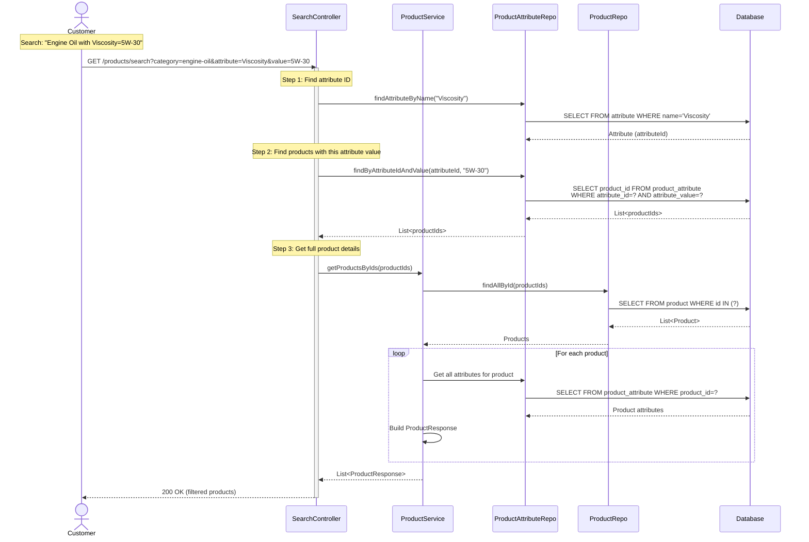
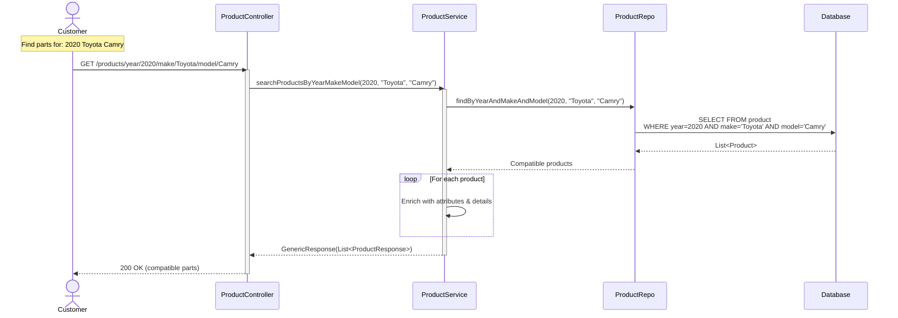
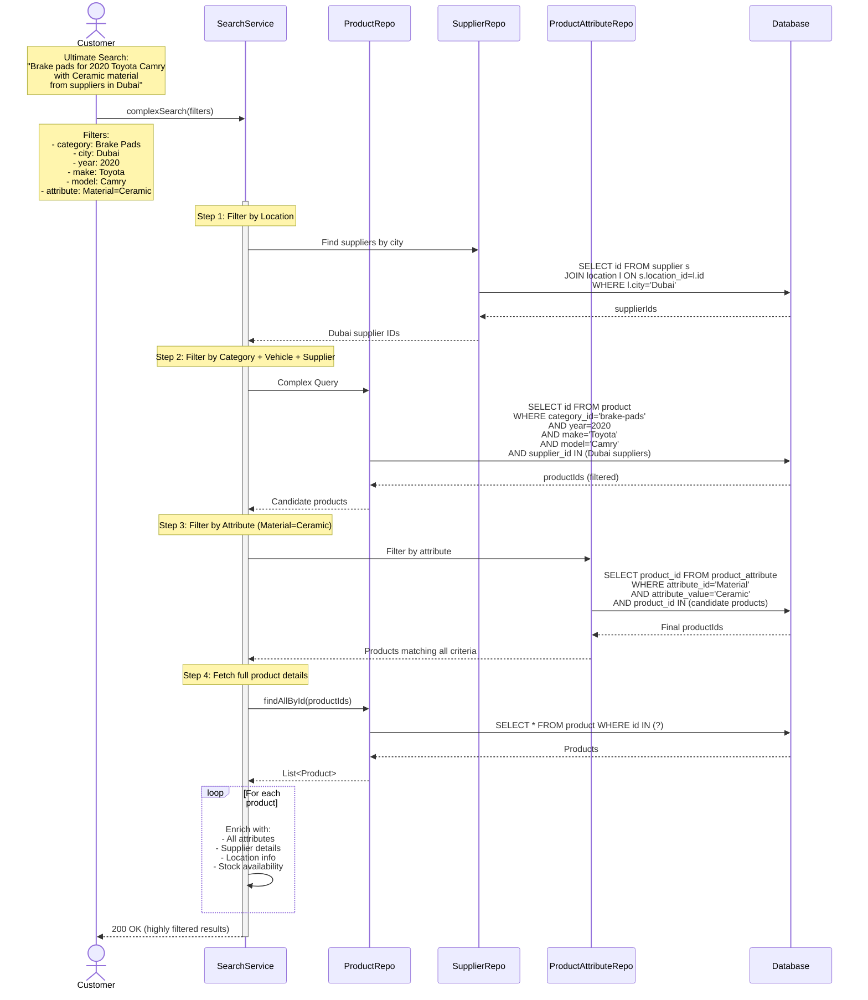
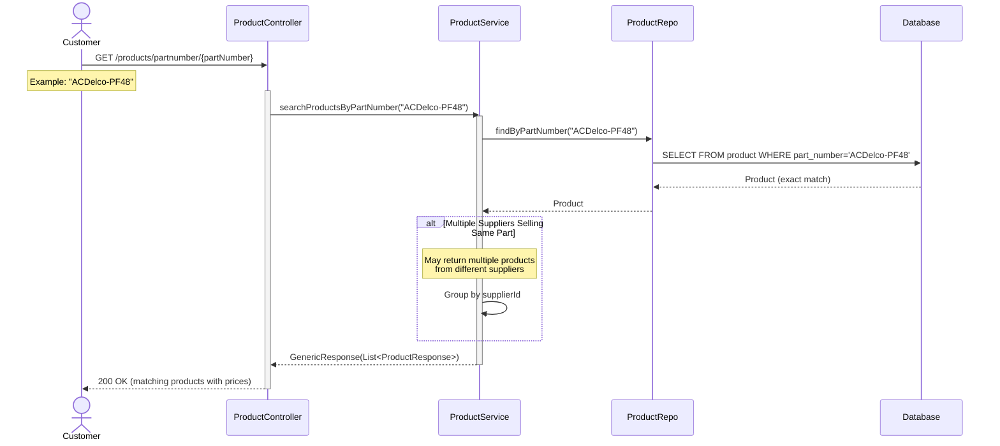
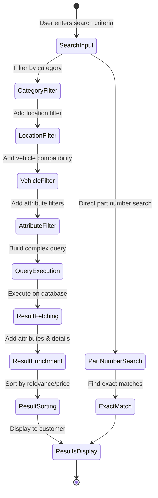
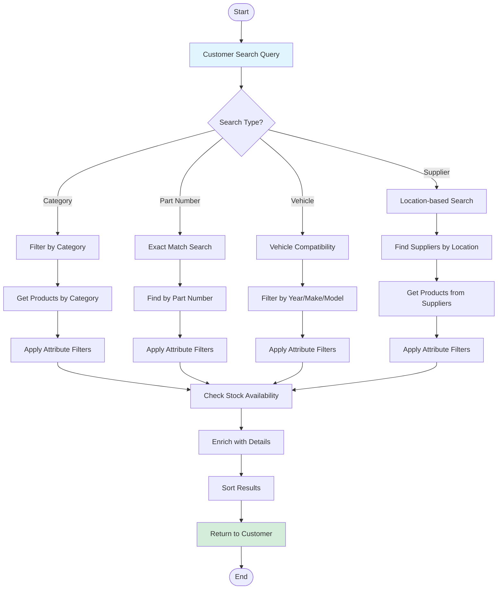
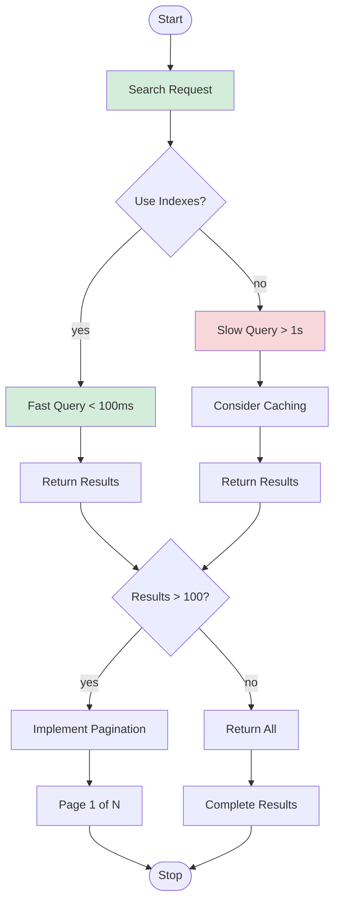

# Part Searching Flow - UML Sequence Diagram

## 1. Simple Search by Category

## 2. Advanced Search - Category + Supplier Location

## 3. Attribute-Based Search (Filter by Specifications)

## 4. Vehicle Compatibility Search

## 5. Complex Multi-Filter Search (Category + Location + Attributes + Vehicle)

## 6. Search by Part Number (Exact Match)

## 7. Search Flow State Diagram

## 8. Search Data Flow

## 9. Search Performance Considerations

