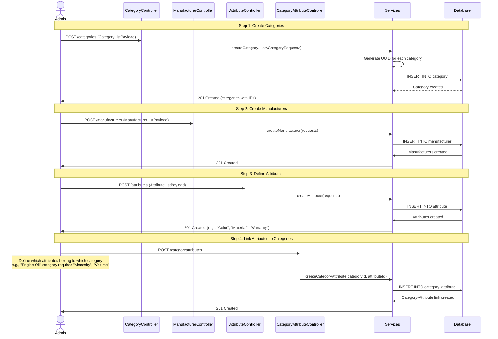
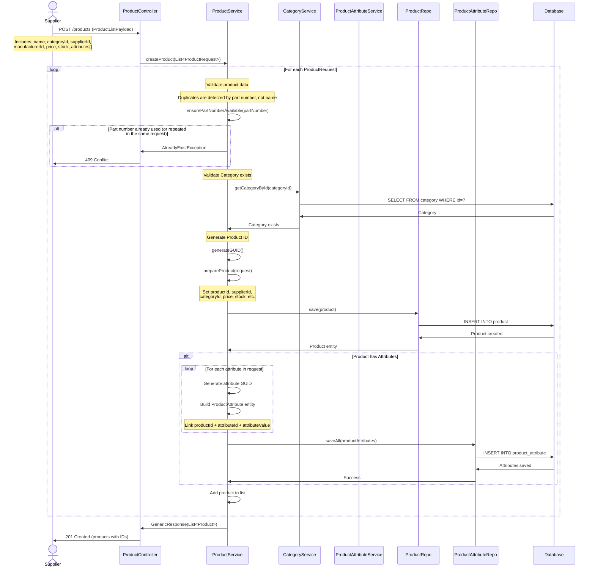
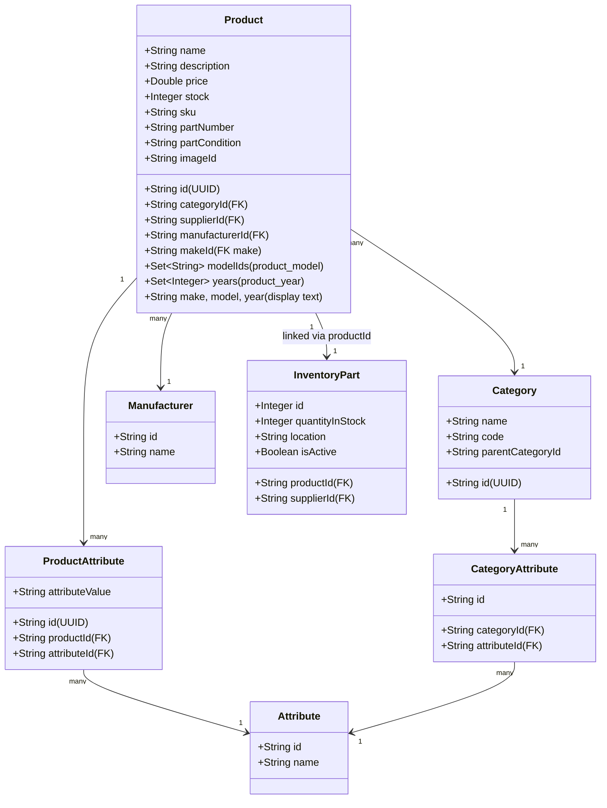

# Product Onboarding Flow - UML Sequence Diagram

## 1. Master Data Setup (Prerequisites)

## 2. Product Creation by Supplier

## 3. Product with Inventory Creation (Complete Flow)

```mermaid
sequenceDiagram
actor Supplier
participant ProductController
participant InventoryController
participant ProductService
participant InventoryService
participant ProductRepo
participant InventoryPartRepo
participant Database

Note over Supplier,Database: Step 1: Create Product (Catalog Item)
Supplier->>ProductController: POST /products (ProductRequest)
ProductController->>ProductService: createProduct(request)
ProductService->>ProductService: generateGUID() -> productId
ProductService->>ProductRepo: save(product)
ProductRepo->>Database: INSERT INTO product
Database->>ProductRepo: Product created
ProductRepo->>ProductService: Product (productId="abc-123")
ProductService->>ProductController: GenericResponse
ProductController->>Supplier: 201 Created (productId="abc-123")

Note over Supplier,Database: Step 2: Create Inventory Part (Warehouse Tracking)
Supplier->>InventoryController: POST /inventory/parts (InventoryPartRequest)
Note over Supplier: Includes: productId="abc-123",<br/>supplierId, location="Shelf-A1",<br/>quantityInStock=100

InventoryController->>InventoryService: addPart(request)
InventoryService->>InventoryService: prepareInventoryPart(request)
Note over InventoryService: Link productId, supplierId<br/>Set quantityInStock, location, isActive=true

InventoryService->>InventoryPartRepo: save(inventoryPart)
InventoryPartRepo->>Database: INSERT INTO inventory_part
Database->>InventoryPartRepo: InventoryPart created
InventoryPartRepo->>InventoryService: InventoryPart entity

InventoryService->>InventoryController: InventoryPart
InventoryController->>Supplier: 200 OK (inventoryPartId, details)

Note over Supplier,Database: Product and InventoryPart are now linked via productId
```

## 4. Product Data Model

## 5. Vehicle fit (make / model / year)

A product fits one make, any number of its models and any number of model years
(every listed model x every listed year).

| Stored in | Holds | Used for |
|---|---|---|
| `product.make_id` | `make.id` | search |
| `product_model (product_id, model_id)` | one row per `model.id` | search |
| `product_year (product_id, year)` | one row per year | search |
| `product.make`, `product.model`, `product.year` | `"Toyota"`, `"Camry, Corolla"`, `"2018, 2019"` | display, old clients |

**Saving** (`POST/PUT /products`): send `makeId`, `modelIds`, `years`, or the legacy text the panel
sends (`make` name, comma-separated `model` names, comma-separated `year`, ranges like `2018-2022`).
`VehicleFitResolver` looks names up, checks that every model belongs to the make and that years are
between 1950 and next year + 5, and rewrites the text columns from the resolved names.
Unknown make/model, a model of another make, or a bad year: 400 with the offending value.
On update, parts not sent are kept.

**Searching**: `POST /products/search/paginated` and `/advanced` (`makeId`/`make`, `modelId`/`model`, `year`),
`GET /products/search/by-vehicle?makeId=&modelId=&year=` (any combination, names also accepted),
`GET /products/year/{year}/make/{make}/model/{model}`. Names are resolved to ids first; an unknown name
returns no results. Products without vehicle data are not returned by vehicle searches.

**Existing products**: `POST /products/vehicle-data/backfill?dryRun=true` reports what would convert and
which values don't match; `dryRun=false` converts the resolvable ones. Already converted products are skipped.
