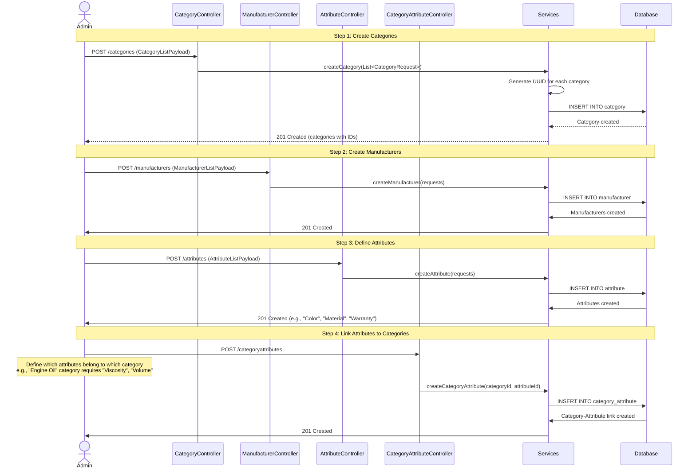
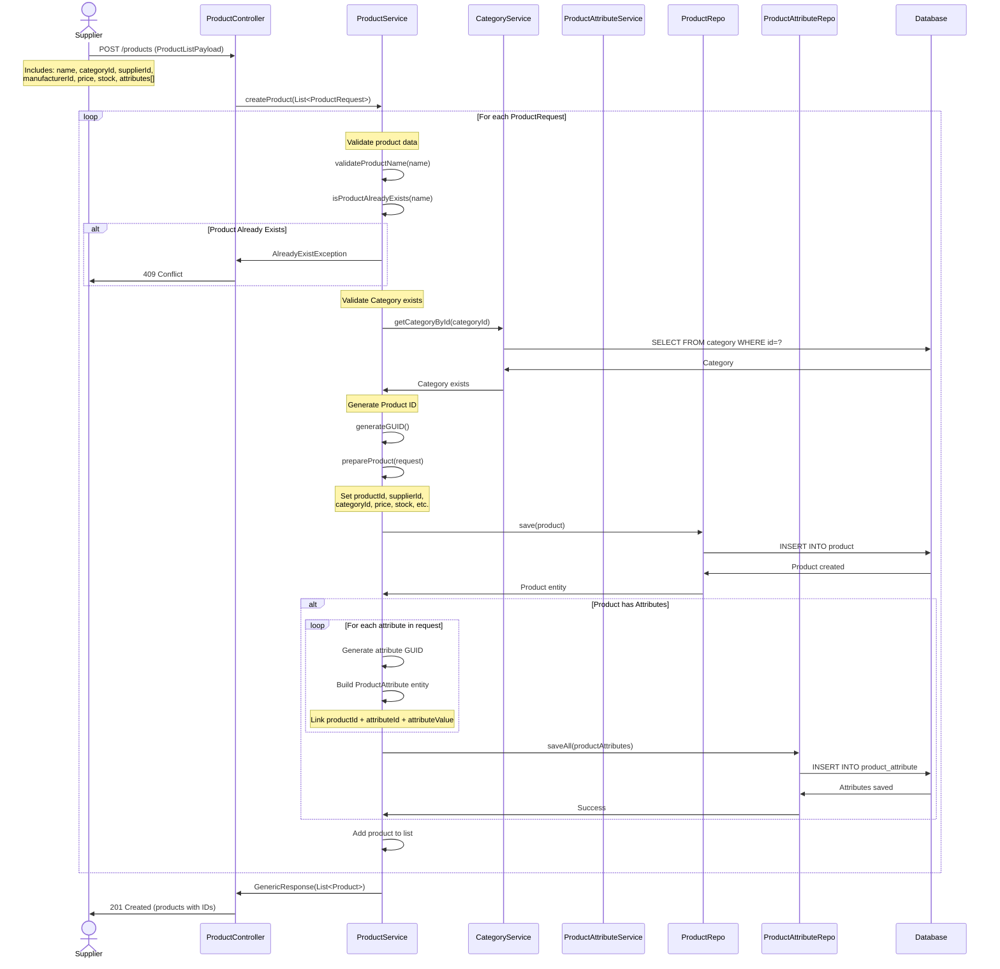
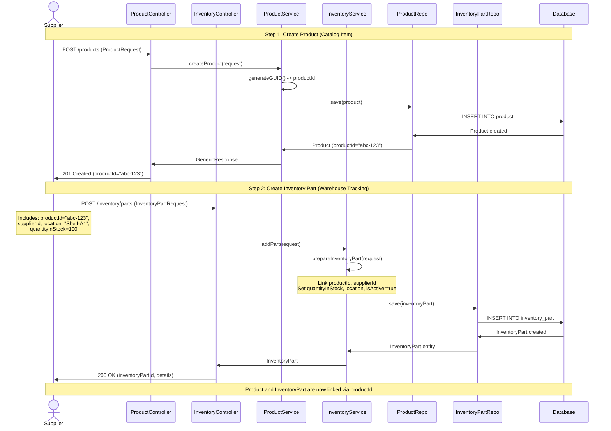
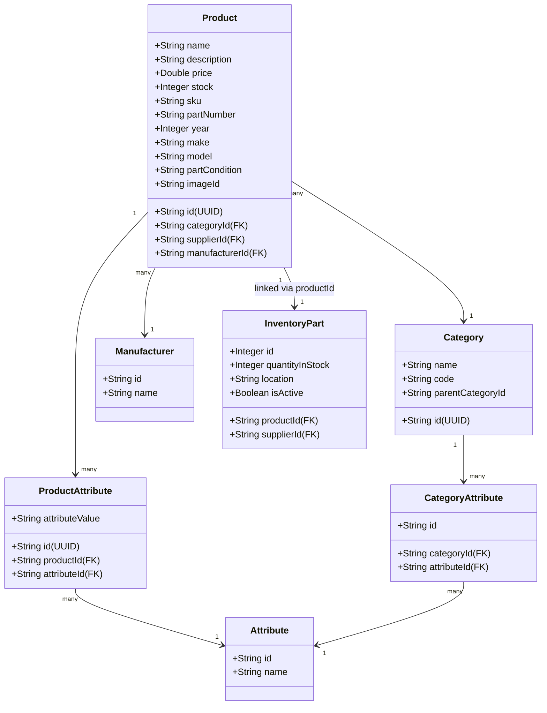

# Product Onboarding Flow - UML Sequence Diagram

## 1. Master Data Setup (Prerequisites)

## 2. Product Creation by Supplier

## 3. Product with Inventory Creation (Complete Flow)

## 4. Product Data Model

